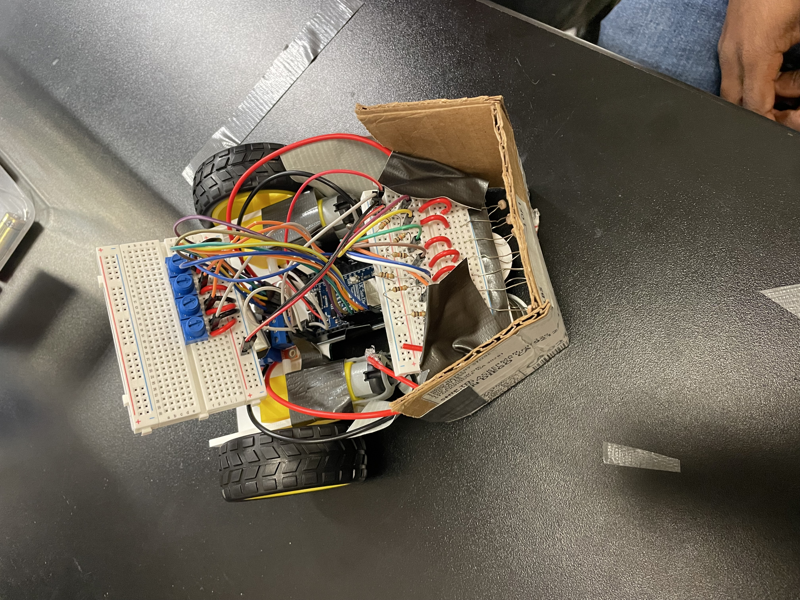

# Piece of 8 Bits - Line Following Robot

Build a simple robot to detect and follow a line by reading photoresistor values.

## Materials used
1x esp32 s3 mini microcontroller\
1x L298N motor driver\
2x motors and wheels\
1x 9V battery and connector

Circuit Components\
Wires, 7x Photoresistors, 2x Breadboards, 10k Ohm Resistors, 4x Potentiometers

## Challenge 1 - The setup
### 1A - Potentiometers
We breadboarded a circuit of potentiometers and resistors as control knobs for the robot. 

### 1B - Photoresistors
We breadboarded a circuit of photoresistors and resistors to measure light absorbed on the track into readable signals. 

### 1C - Motors
The 2 DC motors are powered by a 9V battery and managed by the L298N will bot.

### 1D - Robot Chassis
We added a mount for the ESP32 and extruded the back to give room for other bigger components of the robot. 

## Challenge 2 - Assembling the Robot
Back view of the robot\

Front view\

