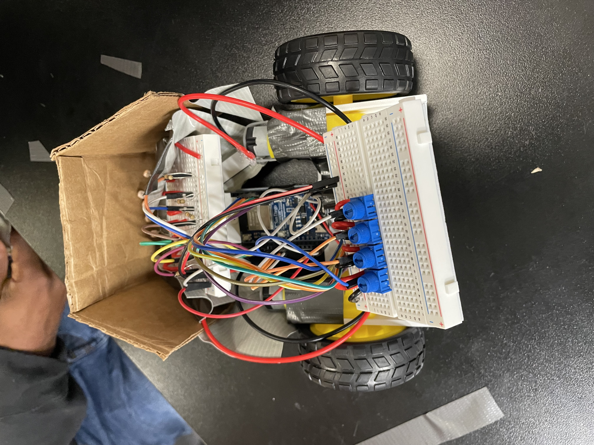

# Piece of 8 Bits - Line Following Robot

Build a simple robot to detect and follow a line by reading photoresistor values.

## Materials used
1x esp32 s3 mini microcontroller\
1x L298N motor driver\
2x motors and wheels\
1x 9V battery and connector

Circuit Components\
Wires, 7x Photoresistors, 2x Breadboards, 10k Ohm Resistors, 4x Potentiometers

## Challenge 1 - The setup
### 1A - Potentiometers
Breadboarded circuit of potentiometers and resistors

This circuit will be our control knobs for the robot, 

### 1B - Photoresistors
Breadboarded circuit of photoresistors and resistors

This circuit will read light signals, 

### 1C - Motors
The 2 DC motors powered by a 9V battery and managed by the L298N will bot.

### 1D - Robot Chassis

## Challenge 2 - Assembling the Robot
Back view of the robot\

Front view\

